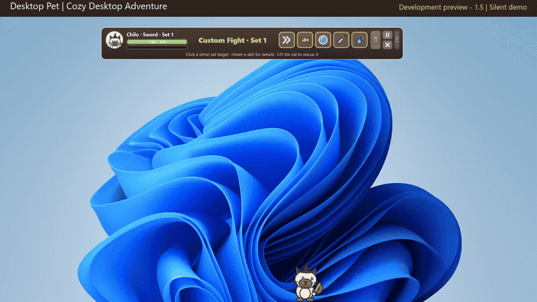
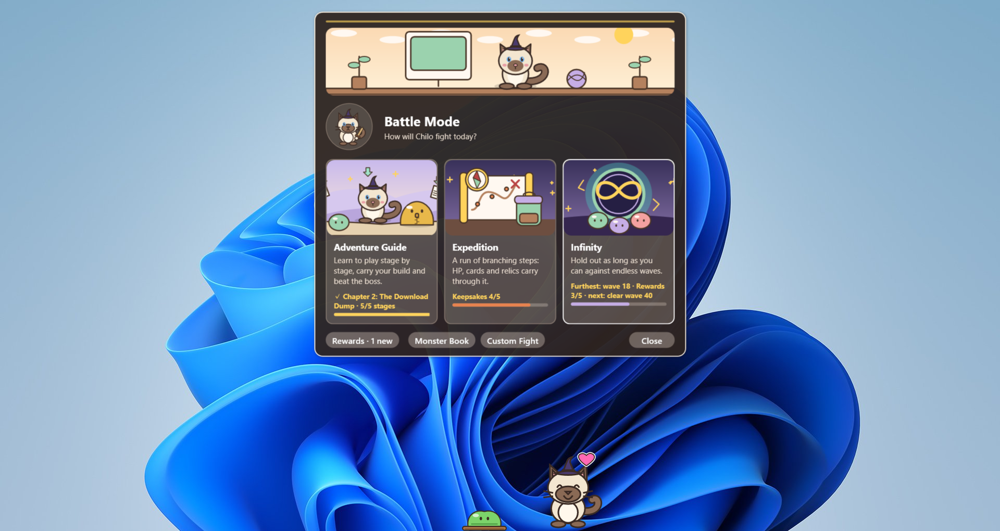
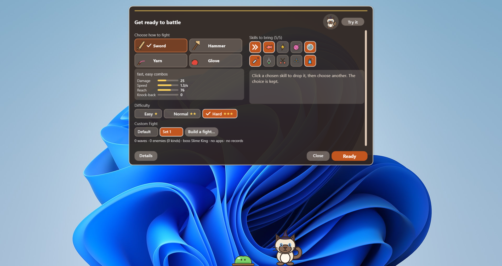
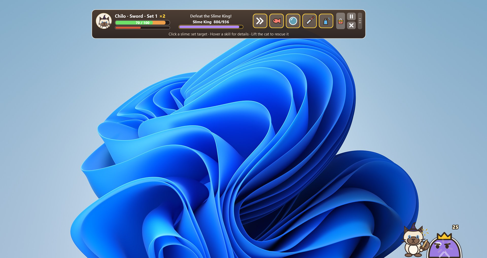

# Desktop Pet for Windows

### A small world on your desktop.

An animated cat to keep you company while you work — and a little adventure when you take a break. Pick it up, play together, dress it up, or help it face a slime invasion across your desktop.

[](docs/media/desktop-pet-intro.mp4)

**[Watch the 32-second introduction (MP4)](docs/media/desktop-pet-intro.mp4)** — real screen recording, with a short screenshot introduction. No audio.

*Development preview for 1.5. The latest published release may differ. The screenshots and recording below come from the running app, not mockups.*

**[Download for Windows](https://github.com/tnpt003/Pet-Computer/releases/latest/download/PetComputer-win-Setup.exe)** · [All releases & portable ZIP](https://github.com/tnpt003/Pet-Computer/releases) · [What's new](CHANGELOG.md) · [Report a problem](https://github.com/tnpt003/Pet-Computer/issues)

Windows 10/11 · x64 · Free and open source · English / Tiếng Việt / 日本語

## See it on your desktop

| Your everyday companion | Pick an adventure |
| --- | --- |
|  |  |
| Choose your gear | Face the Slime King |
|  |  |

Click an image to view it at full size. [Media details and preview version](docs/media/README.md).

## Meet your desktop companion

Your cat walks, jumps, looks around, and curls up to sleep above your windows. Pick it up and it dangles from your cursor; let go to watch it fall and bounce. It can even rest on the top edge of an ordinary application window.

- **Make friends:** pet it, feed it, and play with a ball or laser pointer. Expressions and little reactions give it personality.
- **Make it yours:** choose a coat and accessories, give your cat a name, and discover its diary and keepsakes.
- **Keep things quiet:** pause from the tray, adjust sounds, or use Quiet mode when you want fewer distractions.
- **Take an adventure break:** turn on the optional Battle Mode and help your cat fight slimes with weapons, skills, and upgrade cards.

The theme is **Cozy Desktop Adventure**: a little companion whose everyday desktop becomes a place to explore. The cat is drawn with vector shapes and procedural animation.

## A companion that can go on adventures

Battle Mode is optional and off by default. Outside a battle, your cat stays a desktop companion.

| Mode | What awaits |
| --- | --- |
| Adventure | Progress through stages, learn with guided encounters, and challenge the Slime King. |
| Expedition | Choose a route through fights, rests, and events; carry upgrades and relics through a run. |
| Infinity | See how long your cat can last. |
| Free battle | Set up a fight and try things out. |

During a fight, choose targets, use skills, and lift your cat out of danger. Fictional desktop app icons can help — until a slime infects them. These are game elements, not your real applications.

Features in development are tracked in [the 1.5 plan](docs/UPDATE-1.5.md); check the [release notes](https://github.com/tnpt003/Pet-Computer/releases/latest) for what is included in the download.

## Install and say hello

1. Download **[PetComputer-win-Setup.exe](https://github.com/tnpt003/Pet-Computer/releases/latest/download/PetComputer-win-Setup.exe)**.
2. Run the installer. No administrator rights or separate .NET/Python installation are needed.
3. Choose your language and whether to start with Windows in the welcome window. The startup option is initially checked there.

**Current signing status:** the installer is not code-signed. Edge may show “isn't commonly downloaded,” and Windows may show “Windows protected your PC.” If you have verified the source and choose to continue, use **Keep → Keep anyway** in Edge or **More info → Run anyway** in Windows. You do not need to disable system protection.

Prefer an app you can run from a folder? Get the **portable ZIP** from [Releases](https://github.com/tnpt003/Pet-Computer/releases), extract the whole folder, and run `DesktopPet.exe`. Keep the files together. The portable version does not update itself.

## Your first few minutes

| Action | How |
| --- | --- |
| Pick up your cat | Hold the left mouse button and drag. |
| Throw or gently drop it | Release while moving, or hold still before releasing. |
| Feed, play, customize, or start a battle | Right-click the cat. |
| Pause, change settings, or exit | Right-click the tray icon. |
| Bring it back to the main screen | Double-click the tray icon. |

If the tray icon is hidden, look under the Windows notification area's arrow. Closing a launch terminal does not close the cat; use **Exit** from its menu.

## Updates and your data

The installed version checks GitHub for updates at startup and every six hours. It downloads updates in the background and notifies you from the tray. You can turn automatic updates off or check manually in **Settings → General → Updates**.

Settings, diary entries, and adventure progress are stored locally in `%LOCALAPPDATA%\DesktopPet`. Updates preserve them. Uninstall through **Windows Settings → Apps → Desktop Pet**, or from the app's settings; the in-app uninstaller offers a separate option to delete your cat's data.

The optional Python service runs locally and makes high-level behavior decisions. Movement, input, animation, and battles are handled by C#. The cat continues with local behavior if Python is unavailable. There is no LLM, voice, or computer-vision integration.

## Build and explore

The project uses **C# / WPF on .NET 10**, with an optional Python behavior service. For development, use Windows and the .NET 10 SDK.

```powershell
dotnet build .\src\DesktopPet\DesktopPet.csproj -c Release
powershell -NoProfile -ExecutionPolicy Bypass -File .\scripts\run.ps1
```

The scripts also support a project-local SDK in `.tools\dotnet`. Run without the Python service with `scripts\run.ps1 -NoAi`.

```powershell
# Automated checks, including WPF UI checks
powershell -NoProfile -ExecutionPolicy Bypass -File .\scripts\test.ps1 -Ui

# Package a self-contained Windows folder
powershell -NoProfile -ExecutionPolicy Bypass -File .\scripts\publish.ps1

# Check the published app
powershell -NoProfile -ExecutionPolicy Bypass -File .\scripts\check-publish.ps1
```

Published output is in `artifacts\win-x64`. Distribute the entire folder.

| Explore | Guide |
| --- | --- |
| Windows host, input, physics, and packaging | [Windows guide](docs/WINDOWS.md) |
| Local Python service and fallback | [AI architecture](docs/AI.md) |
| Shared visual and motion direction | [Design system](docs/DESIGN-SYSTEM.md) |
| Battle data and customization | [Battle data](docs/BATTLE-DATA.md) |
| Installer and automatic updates | [Release guide](docs/RELEASE.md) |
| Manual verification | [Manual test checklist](docs/MANUAL-TEST.md) |

Found a bug? [Open an issue](https://github.com/tnpt003/Pet-Computer/issues) with your app version, Windows version, steps to reproduce, and a screenshot if useful. Remove personal information before sharing screenshots or logs.

## License

Project code and original artwork are under the [MIT License](LICENSE). Screenshots and video also show the Windows desktop background, which is not project artwork; see [media notes](docs/media/README.md). Sounds are derived from CC0 recordings; see [sound credits](src/DesktopPet/Assets/Sounds/CREDITS.md). Bundled .NET, Python, and other dependencies retain their respective licenses; the release includes the Python license in `python\LICENSE.txt`.
